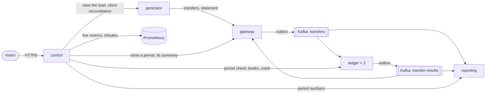

# Ledger Lab

[](https://github.com/obabaikin/ledger-lab/actions/workflows/ci.yml)

**24/7:** an event-driven double-entry ledger under load, with chaos testing and hourly reconciliation.

**Live demo: [ledger-lab.de](https://ledger-lab.de)** — watch the bank; enter your email to get a link, then raise the
load or crash the ledger yourself.

One bank, 100,000 accounts, clients sending 400 transfers per second day and night. Every hour is closed and
reconciled: the books, the bank's events and what the clients were told must agree to the cent, through crashes,
deploys and loads past the limit. Built to answer one question properly: *how do you prove no money was lost or
duplicated while the system keeps moving and its consumers crash?* Work in progress: what is done and what comes next
is in the [Roadmap](#roadmap).

**Contents:** [What it does](#what-it-does) · [How it fits together](#how-it-fits-together) ·
[A period and its verdict](#a-period-and-its-verdict) · [Service levels](#service-levels) ·
[Limits measured on the server](#limits-measured-on-the-server) · [Stack](#stack) · [Modules](#modules) ·
[Running locally](#running-locally) · [How it is tested](#how-it-is-tested) · [Deployment](#deployment) ·
[Failure model](#failure-model) · [Scope and non-goals](#scope-and-non-goals) · [Roadmap](#roadmap) ·
[Design notes](#design-notes) · [Version 1: runs](#version-1-runs)

## What it does

- **One bank that never stops.** 100,000 client accounts of €10,000 each and a pool of €100 million: €1,100,000,000.00
  in all, a sum that must never change. The last 100 accounts are blocked, so some transfers are rejected as in a real
  bank ([ADR 0021](docs/adr/0021-one-bank-around-the-clock.md)).
- A **gateway** accepts transfers over a client-facing API with a client-supplied idempotency key,
  stores them in a transactional outbox and publishes them to Kafka. Retries never duplicate. When too
  many are in progress, it refuses one with `503 busy` before writing anything, and the client retries later.
- The **ledger** applies each transfer as a double-entry posting in PostgreSQL. Delivery is
  at-least-once; processing is idempotent, so crashes and rebalances cannot double-post. The money
  reaches the receiver's balance a moment after the posting, and until then the receiver cannot spend it.
- A **generator** plays the bank's clients: 400 transfers per second, around the clock, each client keeping a journal
  of what the bank told it.
- Transfers can be **rejected** for domain reasons: insufficient funds, blocked account,
  daily limit. Rejections are recorded and reconciled too.
- **Hourly reconciliation.** Each hour is a period. Once it is over and drained, control checks what the clients were
  told, what the gateway accepted, what the ledger posted and what the bank's events say, and inside the ledger the
  balances, the journal and the transfer log. The period is `BALANCED` or `MISMATCH`, with the reason.
- **Visitors with an invite** raise the load for up to 30 s, up to 2000 transfers per second, and press a **chaos
  button** that crashes every ledger instance, as `kill -9` would. The next period must still balance.
- **Service levels**: availability and time to posting, each 99.9 % of minutes over 30 days, with
  their error budgets on the page.

## How it fits together



Gateway, ledger, reporting, control and the generator each own a schema in one PostgreSQL; the generator keeps its
journal of what the clients were told there. Only control is reachable from outside.

## A period and its verdict

A transfer belongs to the hour in which the gateway accepted it. A minute after the hour, control closes it at the
gateway: its entries are fixed, and a later change to them is a mismatch. Ten minutes after the hour control reads the
counts of the gateway and the ledger and waits until every accepted transfer is posted or rejected on both sides. Then
the ledger checks its books for the period and the generator compares its clients' journal with the gateway's
statement, transfer by transfer ([ADR 0009](docs/adr/0009-closing-a-period-and-the-statement.md),
[ADR 0010](docs/adr/0010-client-reconciliation.md)).

The verdict is `BALANCED` or `MISMATCH`, and `MISMATCH` names what disagrees: entries changed after the close, the
gateway's and the ledger's counts, the ledger's check, the sum of all balances, the clients' journal against the
statement. A period without a verdict within 40 minutes of its end is `FAILED` with the reason, never green. The
report shows the invariants, the sums of the books, the crashes inside the period and the bank's events beside the
books ([ADR 0021](docs/adr/0021-one-bank-around-the-clock.md)).

The page shows the bank live: the total in all accounts, the periods with their verdicts, transfers per second, refusals
and the time from acceptance to result over 2 minutes to 2 hours. Every live number comes from a named source, and a
number not read yet shows as "—" ([ADR 0014](docs/adr/0014-the-control-page.md)); the bank's numbers are projected
from its own events ([ADR 0015](docs/adr/0015-live-numbers-from-the-banks-events.md)).

## Service levels

| Objective | A minute is good if | Target |
|---|---|---|
| Availability | at least 99 % of the clients' requests got an answer | 99.9 % of minutes over 30 days |
| Time to posting | at most 1 % of its transfers took longer than 2 s from acceptance to result | 99.9 % of minutes over 30 days |
| Correctness | — | every period `BALANCED` |

Crashes from the page, loads above 1300 per second and maintenance windows declared 3 hours ahead stay out of the
budget, unless a service restarts beyond what the event explains. How each is measured: [SLO](docs/guides/slo.md).
The second objective came from a measurement: the time gateway to ledger stalled behind the outbox publisher, and with
the publisher on a thread of its own the share of time with p99 above 1 s fell from 18 % to none
([p99 analysis](docs/results/2026-11-14-p99-analysis.md)).

## Limits measured on the server

On one node with the whole bank and the load generator, the current version takes **about 1600 transfers per
second** in steps of 30 seconds without a refusal, where the October version refused from 300–400 on; every such run
of both ends `BALANCED`. Held for 5 minutes by day, the same server already refuses at 1300
([comparison](docs/results/2026-11-10-kotlin-vs-java.md)).
How it was measured, how the bottlenecks were found and what was tried and rejected:
[optimizations](docs/results/2026-11-06-optimizations.md). These were measured with the runs of version 1.

On the public demo a visitor raises the load to 400–2000 transactions per second for 10 to 30 s, so they can go past
the limit and watch the bank fall behind and catch up; one raise at a time for all visitors, with a minute between them.

## Stack

Java 25 · Spring Boot 4 · Apache Kafka · PostgreSQL · Flyway · Testcontainers ·
Micrometer / Prometheus · Helm · k3s · cert-manager · Terraform (firewall, DNS); planned: Grafana

Ported from Kotlin in v0.9.0 with the behaviour unchanged; the two versions
[measured side by side](docs/results/2026-11-10-kotlin-vs-java.md).

## Modules

| Module | Purpose |
|---|---|
| `common` | The bank's internal Kafka messages, shared by the bank's services; no logic |
| `ledger-service` | Double-entry ledger, Kafka consumer, period checks, internal API |
| `gateway` | Client-facing transfer API, idempotency keys, transactional outbox, result status, optional wait, period statement |
| `generator` | The bank's clients: a steady load, raised on request, and their journal (virtual threads, retries with the same key) |
| `reporting` | The bank's numbers per period, projected from its Kafka events, internal API |
| `control` | Operations console: closing and reconciling periods, service levels, invites, load and chaos buttons, UI |

## Running locally

Requirements: JDK 25, Docker.

```bash
docker compose up -d                      # Postgres (one schema per service), Kafka and its topics, Prometheus :9090
./gradlew test                            # integration tests with Testcontainers
./gradlew check                           # tests plus dead-code checks: Error Prone, knip (compiler warnings fail every build)
./gradlew :ledger-service:bootRun         # :8080, opens the accounts on its first start
./gradlew :gateway:bootRun                # :8081, the bank's client-facing API
./gradlew :generator:bootRun              # :8082, the clients start sending
./gradlew :reporting:bootRun              # :8084, the period's numbers from the bank's events
./gradlew :control:bootRun                # :8083, the page, periods, service levels, invites (needs the other four)
```

The bank through control, once an [invite](docs/guides/operations.md#invites) exists:

```bash
curl -s localhost:8083/api/bank                    # totals, clients, instances, service levels
curl -s localhost:8083/api/bank/periods            # the last periods with their verdicts
SESSION=$(curl -s -X POST localhost:8083/api/sessions -H 'content-type: application/json' \
  -d '{"token":"<invite token>"}' | jq -r .sessionId)
curl -s -X POST localhost:8083/api/sessions/$SESSION/load -H 'content-type: application/json' \
  -d '{"tps":1000,"seconds":10}'                   # raise the load
curl -s -X POST localhost:8083/api/sessions/$SESSION/chaos   # crash every ledger instance
```

Only control is meant to be reached from outside; gateway, ledger, generator and reporting stay internal.
Local Kubernetes, the server, invites and work on the page: [docs/guides/operations.md](docs/guides/operations.md).

## How it is tested

- **Against real infrastructure.** Integration tests run each service against PostgreSQL and Kafka in
  Testcontainers; neither the database nor the broker is mocked.
- **Contracts.** The Kafka messages between gateway and ledger are pinned field by field. Each service's
  OpenAPI spec is kept in the repository, and a test fails when the running service serves anything
  else. Control and the generator check every call and field they use against the specs of the
  services they call ([ADR 0011](docs/adr/0011-contract-boundaries.md)).
- **The page** has its own tests (Vitest).
- **CI on every pull request:** the tests, dead-code and null checks (Error Prone, NullAway, knip), compiler warnings as
  errors, a secret scan of the whole history, Terraform validation and shellcheck. `main` only takes
  pull requests with green tests and a clean secret scan.
- **The system as a whole** is checked by its own reconciliation: every hour, crashes included, ends with a verdict.

## Deployment

- **Kubernetes:** one Helm chart (`infra/helm/ledger-lab`) runs in k3d on a laptop, on one node the
  size of the server, and on the server's single-node k3s. The ledger runs two instances and the gateway one;
  a deploy replaces the gateway without downtime ([ADR 0020](docs/adr/0020-gateway-deploys-without-downtime.md)),
  the other services stop before their new version starts. A crashed pod restarts within a second. Every pod of the
  chart has a memory limit; the bank, the load generator, monitoring, k3s and the OS fit in the server's 12 GB together.
- **Server:** one VPS (6 vCPU, 12 GB), ordered by hand. Terraform manages only its firewall and the
  DNS record, so no configuration can buy a server.
- **Delivery:** every push to `main` builds the five images in CI and publishes them to GHCR, once;
  a release, a SemVer tag, only adds its name to them, and only a release reaches the server: `deploy.sh v1.0.0`
  deploys it by hand while the clients keep sending and names the version the page shows. A change of a contract
  between the services deploys only within a declared maintenance window.
- **Monitoring:** Prometheus scrapes the services every second, and the node, Postgres (with the statements that take
  the most time) and every container's memory every 5 s.
- **Security:** HTTPS from Let's Encrypt through cert-manager, requests limited per client address,
  a host firewall under the provider's, SSH with a key only, services without root or capabilities.
  Only the page is published.

Details: [docs/guides/operations.md](docs/guides/operations.md#running-on-a-server).

## Failure model

What happens when something fails half-way through a transfer:

| Failure | What happens | Why nothing is lost or doubled |
|---|---|---|
| The ledger crashes in the middle of a posting | The posting is one database transaction: it rolls back, and Kafka delivers the transfer again to the instance that takes over the partition | Offsets are committed only after the transaction ([ADR 0003](docs/adr/0003-idempotent-consumer-never-skips.md)) |
| The commit to the database succeeded, the publish to Kafka did not | The transfer row is its own outbox, in the gateway and in the ledger: the row stays marked unpublished, and a publisher sends it after the restart | The row and the outbox are one write, so there is no state with one and not the other ([ADR 0006](docs/adr/0006-gateway-idempotency-outbox-and-waiting.md)) |
| Kafka delivers the same transfer twice | The second insert of `(accepted_at, transfer_id)` finds the row and changes nothing | Delivery is at-least-once, the effect exactly-once: the key is the guard, not the broker |
| The client sends the same transfer twice | The gateway answers with the current state of the transfer it already has; the same key with another payload is refused with 422 | The client's idempotency key, held for 4 hours |

The trade-off: **accepted is not posted.** The gateway accepts a transfer without waiting for the ledger,
so taking payments does not depend on the ledger being up; the client learns the outcome later, by
asking for the status or retrying with the same key. A crashed ledger delays postings and never loses them.

## Scope and non-goals

Nothing is silently dropped: every discrepancy is either resolved or reported.
What is deliberately left out, and what production would add:

- **Not a system of record.** Transfers, the clients' journal and idempotency keys are kept for 4 hours after their
  period, then their partitions are dropped; the periods' reports and hourly sums stay. Within that time durability is
  complete: a transfer is committed before it is acknowledged. Once a day every account is brought back to its opening
  balance, so the clients never run out of money.
- **No reversals or compensating postings.** Outcomes are reported, not undone. Production would
  add refunds and authorise-then-capture, so money is only taken once the merchant confirms.
- **No schema registry or contract broker.** Contracts are pinned by tests. A reader that meets a
  status or reason it does not know yet keeps what it can apply, and logs and counts the rest. Production would add a schema
  registry for the Kafka messages, a contract broker for clients and a dead-letter topic.
- **One node, no failover.** The server is a single k3s node; if it goes down, so does the system.
- **No continuous deployment.** One server: a release is chosen and deployed by hand. The gateway is replaced without
  downtime; the other services stop for the deploy, and those minutes count against the budget unless announced.
  Production would deploy on merge, roll every service and run several instances.
- **No database backups.** The money is test money; a fresh install starts the books again, and invites are re-issued.
- **No push notifications.** Clients learn outcomes by retrying with the same key or asking for
  the status. Production would add signed webhooks with retried delivery.

## Roadmap

Each goal names how it is checked; a goal is done when the check holds.

| Goal | How it is checked | Status |
|---|---|---|
| Every run reconciles: the books, the bank's events and the client's journal agree | verdict `BALANCED` on each run (version 1) | done |
| Survives crashes mid-run | one hour at 300 TPS on the server, the ledger crashed twice, `BALANCED` (version 1) | done |
| Refuses instead of falling over under overload | `503 busy` with `Retry-After`; 1000 TPS locally without a restart | done |
| Measured limits on the server | the highest rate with no refusals and bounded latency, with node and database metrics: 200 TPS in October ([results](docs/results/2026-10-23-server-baseline.md)), about 1600 in steps of 30 s with batched writes ([optimizations](docs/results/2026-11-06-optimizations.md)); runs of 5 minutes by day already refuse at 1300 ([comparison](docs/results/2026-11-10-kotlin-vs-java.md)) | done |
| Access on request | a visitor enters an email and receives an invite link | done |
| A bank that runs around the clock | a steady load day and night; visitors raise the rate or crash the ledger; closed periods reconciled hourly, service levels and verdicts on the page | done |
| Dashboards | Grafana: latency by segment, node, database | planned |
| Writes in batches, overload shed at the edge | 1000–1600 TPS on the server in steps of 30 s without a refusal in two staircases of three, every run `BALANCED` ([optimizations](docs/results/2026-11-06-optimizations.md)); load above the limit refused at once with `503 busy`, no restart | done |
| The bottleneck, found and explained | measured, with the fix or the reason not to: commits per transfer, then lock waits, then the gateway's memory ([optimizations](docs/results/2026-11-06-optimizations.md)), then the outbox publisher behind the p99 ([p99 analysis](docs/results/2026-11-14-p99-analysis.md)) | done |
| Gateway deploys without downtime | replaced during a 400 TPS run: no transfer lost or duplicated, the run `BALANCED` | done |
| No refusals right after a deploy | the top offered rate right after a deploy: 0 refused | planned |
| Money is never created or lost, in any order of events | property-based tests in CI: random sequences of transfers, duplicates, redeliveries and failures, every invariant checked after each step | planned |
| Nothing received goes unaccounted | every message a service took is booked or reported | planned |

## Design notes

Decisions with their trade-offs are recorded in [docs/adr](docs/adr). The ones the rest stands on:

- **One bank in hourly periods.** No run starts or stops; each hour is closed at the gateway, drained and reconciled
  while the next one fills, by a state machine stepped every second from a table, so a restart of control resumes
  where it stopped ([ADR 0021](docs/adr/0021-one-bank-around-the-clock.md)).
- **Two idempotency guards.** The gateway takes the client's key in a table of its own before it writes the transfer;
  the ledger inserts on `(accepted_at, transfer_id)` with `ON CONFLICT DO NOTHING`, so a redelivery or a race after a
  rebalance never posts twice ([ADR 0003](docs/adr/0003-idempotent-consumer-never-skips.md),
  [ADR 0006](docs/adr/0006-gateway-idempotency-outbox-and-waiting.md)).
- **The transfer row is the outbox.** A transfer is committed and answered before Kafka is involved;
  publishers claim rows with `FOR UPDATE SKIP LOCKED` ([ADR 0006](docs/adr/0006-gateway-idempotency-outbox-and-waiting.md)).
- **A ledger that stalls rather than skips.** Offsets are committed after processing, and errors are
  retried without end: a crash can cause redelivery, never loss ([ADR 0003](docs/adr/0003-idempotent-consumer-never-skips.md)).
- **Reconciliation from independent views.** Balances, the journal and the transfer log are checked
  against each other per transfer, in one snapshot ([ADR 0002](docs/adr/0002-double-entry-journal-and-reconciliation.md)),
  and the clients' journal against the bank's statement by transfer id ([ADR 0010](docs/adr/0010-client-reconciliation.md)).
- **Batched writes.** The gateway accepts submissions, the ledger posts transfers and the gateway
  records results a batch per transaction, each transfer with the outcome it would have had alone. A
  batch locks only its senders; credits wait in a table until one applier adds them to the balances,
  and reconciliation counts them meanwhile ([ADR 0018](docs/adr/0018-deferred-credits.md),
  [ADR 0019](docs/adr/0019-batched-writes-one-result-writer-load-shedding.md)).
- **Overload is shed at the edge.** Past a limit of open submissions the gateway answers `503 busy`
  at once instead of filling its heap ([ADR 0019](docs/adr/0019-batched-writes-one-result-writer-load-shedding.md)).
- **Hand-written SQL, no ORM**, so every lock and query of the ledger is visible ([ADR 0001](docs/adr/0001-jdbc-instead-of-jpa.md)).

## Version 1: runs

Up to `v0.9.0` the system was a set of runs: a visitor chose a rate, the run got its own accounts, its clients sent
for up to 30 s, and control drained the bank and gave the run a verdict. One trial hour on the server at 300 TPS, the
ledger crashed twice, ended `BALANCED` with 1,079,295 transfers accepted. Between runs the bank stood idle, so nothing
showed how it behaves over hours, through deploys and crashes at any moment; version 2 keeps one bank running instead
([ADR 0021](docs/adr/0021-one-bank-around-the-clock.md)). The README of version 1:
[docs/v1/README.md](docs/v1/README.md); the code: tag [`v0.9.0`](https://github.com/obabaikin/ledger-lab/tree/v0.9.0).

Built by Oleksii Babaikin · [LinkedIn](https://www.linkedin.com/in/oleksii-babaikin)
