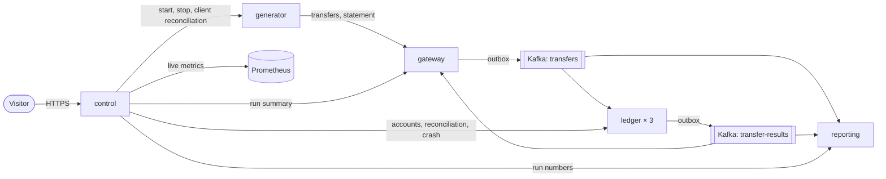
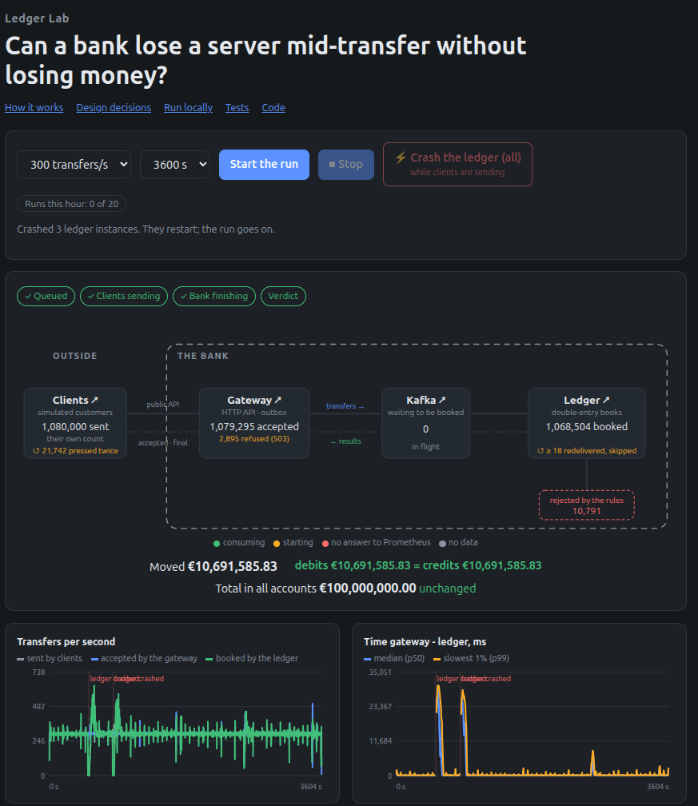
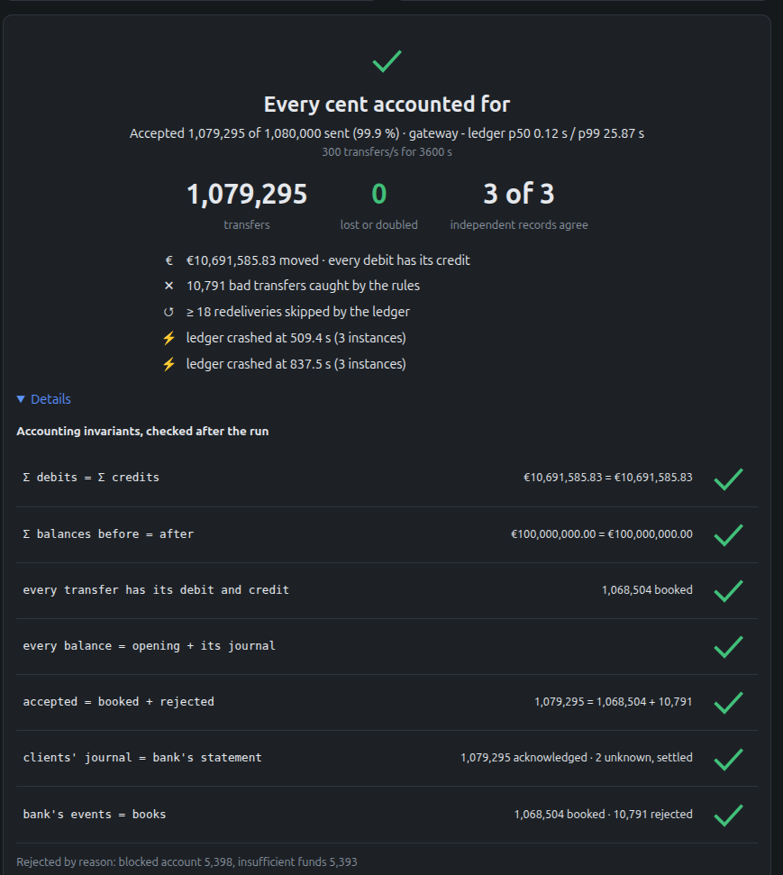

# Ledger Lab

[](https://github.com/obabaikin/ledger-lab/actions/workflows/ci.yml)

An event-driven double-entry ledger under load, with chaos testing and three-way reconciliation.

Pick a transaction rate, run it for up to half a minute, kill the ledger mid-run, and watch the books
still balance. Built to answer one question properly: *how do you prove no money was lost or
duplicated when consumers crash?*

**Live:** [ledger-lab.de](https://ledger-lab.de) opens with an invite link; invites on request via
[LinkedIn](https://www.linkedin.com/in/oleksii-babaikin). Work in progress: what is done and what comes
next is in the [Roadmap](#roadmap).

**Contents:** [What it does](#what-it-does) · [How it fits together](#how-it-fits-together) ·
[A run and its verdict](#a-run-and-its-verdict) · [One hour on the server](#one-hour-on-the-server) ·
[Limits measured on the server](#limits-measured-on-the-server) ·
[Stack](#stack) · [Modules](#modules) · [Running locally](#running-locally) · [How it is tested](#how-it-is-tested) ·
[Deployment](#deployment) · [Failure model](#failure-model) · [Scope and non-goals](#scope-and-non-goals) · [Roadmap](#roadmap) · [Design notes](#design-notes)

## What it does

- A **gateway** accepts transfers over a client-facing API with a client-supplied idempotency key,
  stores them in a transactional outbox and publishes them to Kafka. Retries never duplicate. When too
  many are in progress, it refuses one with `503 busy` before writing anything, and the client retries later.
- The **ledger** applies each transfer as a double-entry posting in PostgreSQL. Delivery is
  at-least-once; processing is idempotent, so crashes and rebalances cannot double-post.
- A **generator** plays the bank's clients: it calls the gateway at 50, 100 or 200
  transactions per second and counts what was acknowledged.
- Transfers can be **rejected** for domain reasons: insufficient funds, blocked account,
  daily limit. Rejections are recorded and reconciled too.
- Every run gets its own **isolated set of accounts**, so several people can run experiments
  at the same time against the same cluster.
- **Reconciliation** cross-checks what the clients were told, what the gateway accepted,
  what Kafka carried and what the ledger posted, and inside the ledger the balances, the
  journal and the transfer log. Any disagreement turns the run red, and so does a verdict that
  could not be completed.
- A **chaos button** crashes every ledger instance in the middle of a run, as `kill -9` would.
  Reconciliation must still pass.

## How it fits together



Gateway, ledger, reporting and control each own a schema in one PostgreSQL; the generator keeps its
journal of what the clients were told in memory. Only control is reachable from outside.

## A run and its verdict

On the page, choose a rate and a duration and press Start. The page shows the run in four phases:
queued, clients sending, bank finishing, verdict. While it runs, you see the way a transfer takes from
the clients through the gateway and Kafka to the ledger, with live counts and the state of each
instance; transfers per second; the time from the gateway to the ledger; and the crash button. Every live number comes from a named
source, and a number not read yet shows as "—" ([ADR 0014](docs/adr/0014-the-control-page.md)); they
are projected from the bank's own events ([ADR 0015](docs/adr/0015-live-numbers-from-the-banks-events.md)).

A run ends with a report: `BALANCED`, `BREAKS` or `INCOMPLETE` with the reasons, and only `BALANCED`
is green ([ADR 0013](docs/adr/0013-orchestrating-a-run-and-the-verdict.md)). It shows the sums of the
books: debits against credits and the total of all accounts before and after.

### One hour on the server

A trial run on the server: 300 transfers per second for one hour, on 6 vCPU with the bank capped at
8 GB RAM and the load generator beside it. All three ledger instances were crashed twice. Of 1,080,000
transfers sent, the gateway accepted 1,079,295 and the ledger booked 1,068,504 and rejected 10,791 by
its rules. The verdict is `BALANCED`: none lost or doubled, debits equal credits, and the total of all
accounts did not change.

- 2,895 transfers met a `503 busy` from the gateway at least once; 703 met it three times, and the
  client gave up on them as failed. The gateway refuses before it writes anything, and the statement
  confirms none of them was booked.
- The gateway-to-ledger p99 of 25.9 s is the crashes: transfers waited in Kafka while the ledger was
  down. The median is 0.12 s.
- Runs on the page last up to 30 s; this hour ran with limits raised for the trial.





## Limits measured on the server

The same node, measured rate by rate ([full results](docs/results/2026-10-23-server-baseline.md)):

- **200 transfers per second sustained**: two runs of 120 s with no refusal, client p99 under 1 s, every
  transfer booked within 10 s of the end. At 250–300 one run of two refuses; at 500 the gateway refuses
  thousands, and every run still ends `BALANCED`.
- **The limit is the node's CPU**, PostgreSQL its largest consumer; not the disk and not the hypervisor.
  At 500 TPS the pods use 4.2 of 6 cores, and the node at most 6.4 of its 12 GB.
- **A crash of every ledger instance at 150 TPS** is absorbed within 47 s, with nothing refused.
- **Right after a restart of the gateway** a run waits until it has warmed up; then two runs of 4,000
  transfers had 1 and 0 refused. Right after a full deploy every service starts cold on the same node, and a
  run still meets refusals; the fix is planned with the optimizations.

At most three runs hold a place at once, together at most 300 transactions per second, and only
once the ledger instances hold all partitions and the gateway has warmed up; the rest wait in a queue for up to five minutes ([ADR 0012](docs/adr/0012-invites-quota-and-the-run-queue.md)).

## Stack

Kotlin · Spring Boot 4 · Apache Kafka · PostgreSQL · Flyway · Testcontainers ·
Micrometer / Prometheus · Helm · k3s · cert-manager · Terraform (firewall, DNS); planned: Grafana

## Modules

| Module | Purpose |
|---|---|
| `common` | The bank's internal Kafka messages, shared by the bank's services; no logic |
| `ledger-service` | Double-entry ledger, Kafka consumer, reconciliation, internal API |
| `gateway` | Client-facing transfer API, idempotency keys, transactional outbox, result status, optional wait |
| `generator` | Load simulator acting as the bank's clients (coroutines, retries with the same key) |
| `reporting` | The bank's numbers per run, projected from its Kafka events, internal API |
| `control` | Operations console: invites, the run queue, reconciliation, chaos button, UI |

## Running locally

Requirements: JDK 21, Docker.

```bash
docker compose up -d                      # Postgres (one schema per service), Kafka and its topics, Prometheus :9090
./gradlew test                            # integration tests with Testcontainers
./gradlew check                           # tests plus dead-code checks: detekt, knip (compiler warnings fail every build)
./gradlew :ledger-service:bootRun         # :8080
./gradlew :gateway:bootRun                # :8081, the bank's client-facing API
./gradlew :generator:bootRun              # :8082
./gradlew :reporting:bootRun              # :8084, the run's numbers from the bank's events
./gradlew :control:bootRun                # :8083, the page, invites, the run queue and orchestration (needs the other four)
```

A run through control, once an [invite](docs/guides/operations.md#invites) exists:

```bash
SESSION=$(curl -s -X POST localhost:8083/api/sessions -H 'content-type: application/json' \
  -d '{"token":"<invite token>"}' | jq -r .sessionId)
RUN=$(curl -s -X POST localhost:8083/api/sessions/$SESSION/runs -H 'content-type: application/json' \
  -d "{\"requestId\":\"$(uuidgen)\",\"tps\":100,\"durationSeconds\":10}" | jq -r .runId)
curl -s localhost:8083/api/sessions/$SESSION/runs/$RUN          # QUEUED, CREATED, RUNNING, DRAINING, RECONCILED
curl -s -X POST localhost:8083/api/sessions/$SESSION/runs/$RUN/stop # optional: stop the clients early
curl -s localhost:8083/api/sessions/$SESSION/runs/$RUN/report   # the verdict and what it rests on
```

Every step control takes, by hand against the services' internal APIs, and how a client reads the
gateway's answers: [docs/guides/run-by-hand.md](docs/guides/run-by-hand.md). Only control is meant to
be reached from outside; gateway, ledger, generator and reporting stay internal.

Local Kubernetes, the server, invites and work on the page: [docs/guides/operations.md](docs/guides/operations.md).

## How it is tested

- **Against real infrastructure.** Integration tests run each service against PostgreSQL and Kafka in
  Testcontainers; neither the database nor the broker is mocked.
- **Contracts.** The Kafka messages between gateway and ledger are pinned field by field. Each service's
  OpenAPI spec is kept in the repository, and a test fails when the running service serves anything
  else. Control and the generator check every call and field they use against the specs of the
  services they call ([ADR 0011](docs/adr/0011-contract-boundaries.md)).
- **The page** has its own tests (Vitest).
- **CI on every pull request:** the tests, dead-code checks (detekt, knip), compiler warnings as
  errors, a secret scan of the whole history, Terraform validation and shellcheck. `main` only takes
  pull requests with green tests and a clean secret scan.
- **The system as a whole** is checked by its own reconciliation: every run, crashes included, ends
  with a verdict.

## Deployment

- **Kubernetes:** one Helm chart (`infra/helm/ledger-lab`) runs in k3d on a laptop, on one node the
  size of the server, and on the server's single-node k3s. The ledger runs three instances; a crashed
  pod restarts within a second. Every pod of the chart has a memory limit; the bank fits in 8 GB together with k3s and
  the OS, and the load generator runs beside it.
- **Server:** one VPS (6 vCPU, 12 GB), ordered by hand. Terraform manages only its firewall and the
  DNS record, so no configuration can buy a server.
- **Delivery:** every push to `main` builds the five images in CI and publishes them to GHCR;
  `deploy.sh <sha>` deploys a commit by hand and refuses while runs are in progress. Each service stops
  before its new version starts; the gateway warms up while it already takes traffic, and no run starts
  until it is done.
- **Security:** HTTPS from Let's Encrypt through cert-manager, requests limited per client address,
  a host firewall under the provider's, SSH with a key only, services without root or capabilities.
  Only the page is published.
- **Load:** the server offers 50 / 100 / 200 transactions per second, 100 by default, and at most
  300 for all runs together.

Details: [docs/guides/operations.md](docs/guides/operations.md#running-on-a-server).

## Failure model

What happens when something fails half-way through a transfer:

| Failure | What happens | Why nothing is lost or doubled |
|---|---|---|
| The ledger crashes in the middle of a posting | The posting is one database transaction: it rolls back, and Kafka delivers the transfer again to the instance that takes over the partition | Offsets are committed only after the transaction ([ADR 0003](docs/adr/0003-idempotent-consumer-never-skips.md)) |
| The commit to the database succeeded, the publish to Kafka did not | The transfer row is its own outbox, in the gateway and in the ledger: the row stays marked unpublished, and a publisher sends it after the restart | The row and the outbox are one write, so there is no state with one and not the other ([ADR 0006](docs/adr/0006-gateway-idempotency-outbox-and-waiting.md)) |
| Kafka delivers the same transfer twice | The second insert of `(run_id, transfer_id)` finds the row and changes nothing | Delivery is at-least-once, the effect exactly-once: the key is the guard, not the broker |
| The client sends the same transfer twice | The gateway answers with the current state of the transfer it already has; the same key with another payload is refused with 422 | The client's idempotency key, `ON CONFLICT DO NOTHING` |

The trade-off: **accepted is not posted.** The gateway accepts a transfer without waiting for the ledger,
so taking payments does not depend on the ledger being up; the client learns the outcome later, by
asking for the status or retrying with the same key. A crashed ledger delays postings and never loses them.

## Scope and non-goals

Nothing is silently dropped: every discrepancy is either resolved or reported.
What is deliberately left out, and what production would add:

- **Not a system of record.** A run is a disposable experiment with its own accounts, to be deleted
  after a day. Within a run durability is complete: a transfer is committed before it is
  acknowledged.
- **No reversals or compensating postings.** Outcomes are reported, not undone. Production would
  add refunds and authorise-then-capture, so money is only taken once the merchant confirms.
- **No schema registry or contract broker.** Contracts are pinned by tests. A reader that meets a
  status or reason it does not know yet keeps what it can apply, and logs and counts the rest. Production would add a schema
  registry for the Kafka messages, a contract broker for clients and a dead-letter topic.
- **One node, no failover.** The server is a single k3s node; if it goes down, so does the system.
- **No continuous deployment.** One server with runs in progress: a deploy is chosen by hand and
  waits for runs to end. Production would deploy on merge with rolling updates and several instances.
- **No database backups.** Runs are disposable and deleted after 24 hours; invites are re-issued.
- **No push notifications.** Clients learn outcomes by retrying with the same key or asking for
  the status. Production would add signed webhooks with retried delivery.

## Roadmap

Each goal names how it is checked; a goal is done when the check holds.

| Goal | How it is checked | Status |
|---|---|---|
| Every run reconciles: the books, the bank's events and the client's journal agree | verdict `BALANCED` on each run | done |
| Survives crashes mid-run | one hour at 300 TPS on the server, the ledger crashed twice, `BALANCED` | done |
| Refuses instead of falling over under overload | `503 busy` with `Retry-After`; 1000 TPS locally without a restart | done |
| Measured limits on the server | the highest rate with no refusals and bounded latency, with node and database metrics: 200 TPS, the node's CPU the limit ([results](docs/results/2026-10-23-server-baseline.md)) | done |
| Access on request | a visitor enters an email and receives an invite link | next |
| A bank that runs around the clock | a steady load day and night; visitors raise the rate or crash services; closed periods reconciled hourly, uptime and results on the page | planned |
| Dashboards | Grafana: latency by segment, node, database | planned |
| The bottleneck, found and explained | measured, with the fix or the reason not to | planned |
| No refusals right after a deploy | the top offered rate right after a deploy: 0 refused | planned |
| Money is never created or lost, in any order of events | property-based tests in CI: random sequences of transfers, duplicates, redeliveries and failures, every invariant checked after each step | planned |
| Nothing received goes unaccounted | every message a service took is booked or reported | planned |
| IBAN account numbers at the API (optional) | the gateway validates and maps IBANs | planned |

## Design notes

Decisions with their trade-offs are recorded in [docs/adr](docs/adr). The ones the rest stands on:

- **Two idempotency guards.** The gateway takes the client's key with `ON CONFLICT DO NOTHING`; the
  ledger does the same on `(run_id, transfer_id)`, so a redelivery or a race after a rebalance never
  posts twice ([ADR 0003](docs/adr/0003-idempotent-consumer-never-skips.md), [ADR 0006](docs/adr/0006-gateway-idempotency-outbox-and-waiting.md)).
- **The transfer row is the outbox.** A transfer is committed and answered before Kafka is involved;
  publishers claim rows with `FOR UPDATE SKIP LOCKED` ([ADR 0006](docs/adr/0006-gateway-idempotency-outbox-and-waiting.md)).
- **A ledger that stalls rather than skips.** Offsets are committed after processing, and errors are
  retried without end: a crash can cause redelivery, never loss ([ADR 0003](docs/adr/0003-idempotent-consumer-never-skips.md)).
- **Reconciliation from independent views.** Balances, the journal and the transfer log are checked
  against each other per transfer, in one snapshot ([ADR 0002](docs/adr/0002-double-entry-journal-and-reconciliation.md)),
  and the clients' journal against the bank's statement by transfer id ([ADR 0010](docs/adr/0010-client-reconciliation.md)).
- **Hand-written SQL, no ORM**, so every lock and query of the ledger is visible ([ADR 0001](docs/adr/0001-jdbc-instead-of-jpa.md)).

Built by Oleksii Babaikin · [LinkedIn](https://www.linkedin.com/in/oleksii-babaikin)
