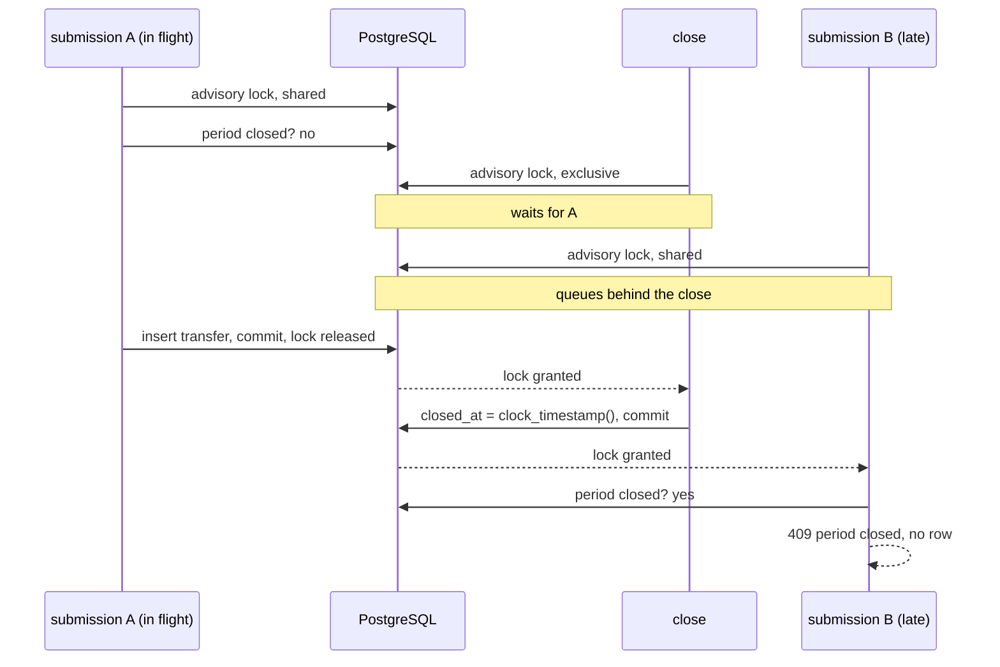

# ADR 0009: Closing a period and the statement

Status: accepted · Date: 2026-10-11

## Context

A client that got no answer reports the transfer as unknown (ADR 0006). Retrying with the same
key settles it, but a client that has stopped retrying needs another way, and banks give one: the
statement. Stripe's reconciliation reports, Adyen's settlement details and camt.053 all list what
the bank booked in a period, so the client can match its own records against them.

"Not in the statement, so not booked" only holds if nothing can commit after the statement is
read. The run's drain check (applied by the ledger equals accepted by the gateway) has the same
blind spot: an insert that is still in flight is not counted yet. A gateway transaction timeout
does not close that gap. It starts with the transaction, after the request may already have
waited for a pooled connection, and it does not cover the commit itself.

## Decision

**Closing a period is a lock handover, not a timeout.**
- Every submission takes the run's advisory lock in shared mode for its transaction, then checks,
  in a separate statement, whether the period is closed. Under READ COMMITTED each statement takes
  a fresh snapshot, so the check sees a close that committed while the submission waited.
- `POST /internal/runs/{runId}/close` takes the same lock exclusively. It waits until the
  submissions holding the lock have committed or rolled back, then records `closed_at`, read
  after the wait (`clock_timestamp()`, not the transaction start), so every transfer in the
  statement was accepted before it. In the same SQL statement it counts the run's transfers into
  `entry_count`. From then on no new transfer of the run can commit; the guarantee comes from the
  lock, not from comparing clocks.
- While a close waits, new submissions of that run queue behind it, so the wait is bounded by
  `gateway.close-lock-timeout` (5 s). On expiry the answer is 503 and the period stays open;
  closing is idempotent, so the caller retries.
- The period is to be closed by the control service once the run's client is done, and before
  draining, so the accepted count the drain compares against is final.
- Advisory locks live in memory and write nothing, unlike `SELECT … FOR SHARE` on a run row,
  which would churn multixacts at every submission. The key is a 64-bit hash of the
  run id; a collision with another run only adds waiting, never a wrong answer.

A close racing two submissions of the run with new keys: one already in flight, one arriving
while the close waits.

A is in the statement with `acceptedAt` before `closedAt`; B never commits a row.

**After the close a new key is refused, a known key is answered as before.** A submission with a
new `transferId` gets 409 `period closed` and leaves no row. A repeat of an accepted key still
gets its current state, and another payload under it still gets 422. To the client, 409 means
"not accepted, retrying will not help".

**The statement exists only for a closed period.**
`GET /v1/runs/{runId}/statement?after=&limit=` lists every transfer accepted in the run, with
accounts, amount, status, reject reason and the bank's timestamps, ordered by
`(acceptedAt, transferId)`. Before the close it answers 409 `period not closed`, also for a run
the gateway has never seen. A keyset cursor on a live table could skip a row that commits behind
it with an earlier `acceptedAt`, and a statement that may be incomplete without saying so is
worse than none.
- The cursor is the last `transferId` of the previous page (`next`), the way Stripe uses
  `starting_after`. `next` is null on the last page. A cursor outside the run is a 400.
- `limit` is 1 to 1000, 100 by default.
- Every page carries `entryCount`: the lines of the whole statement, of any status, counted at the
  close and stored with the period, like the control totals of camt.053 and MT940 statements. Paging
  alone does not show a client that a line was lost; with the count it can prove it read them all:
  no `transferId` twice, and exactly `entryCount` lines after the last page.
- Statuses can still be `ACCEPTED` or `PUBLISHED` right after the close: the ledger may not have
  applied everything yet. Waiting for the drain is up to the caller.

**Considered and rejected.**
- The whole statement in one answer: no paging to get wrong, but at 180 000 lines it would need a
  long timeout and about 100 MB per request in the gateway.
- A control sum of amounts next to the count: a closed period's amounts do not change, and the
  client already compares every line's amount and accounts (ADR 0010), so the sum would catch
  nothing new.
- Running totals per page: the count and the repeated-id check already show a lost or repeated page.

## Consequences

- A client can settle every unknown transfer: in the statement means accepted by the bank, absent
  means never accepted. Matching is by `transferId` and amount.
- The drain check becomes exact: after the close, the gateway's accepted count cannot grow.
- Each submission costs one in-memory lock and one primary-key lookup on `run_periods`.
- The bank decides when the period closes, not the client, so a run whose client is lost can
  still be closed and reconciled.
- `entryCount` is required, so a client that checks it cannot read a statement from a gateway
  older than itself. The gateway is released first, then its clients (ADR 0011).
- Deleting a run removes its period. The run id is not reused afterwards, so a new submission
  under it is not guarded against.
