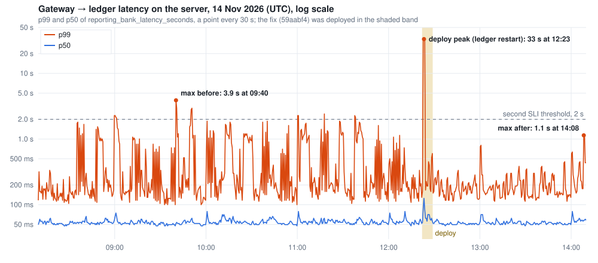

# p99 gateway → ledger on the server (2026-11-14)

The page's chart "Time gateway - ledger, ms" showed p99 plateaus of 1.5–2 s and peaks up to 4.8 s at all hours, not only
while a period closes (XX:01–XX:05). This note finds what the plateaus and peaks coincide with. Read-only: Prometheus
(1 s scrape for the services, 5 s for the node and Postgres exporters; retention 5 d), the Postgres log,
`pg_stat_activity` sampled once a second for 15 min, code at `aa0ecb6`.

## What the metric measures

`reporting_bank_latency_seconds` (`BankLatency`) runs from `acceptedAt` (the gateway's `clock_timestamp()` when it took the
key) to `processedAt`. That is `transfers.processed_at DEFAULT now()` in the ledger, the **start** of the ledger batch's
transaction. So it counts the time in the gateway's outbox, in Kafka and in the ledger's queue up to the batch that books
the transfer. It does not count the time the batch itself takes.

It is a Micrometer **summary** (`publishPercentiles`, no `_bucket` series). Micrometer's defaults give a sliding window of
about 2 min (3 buffers rotating every 40 s), so one stall stays in the p99 for 1–2 minutes.

## Cause

**The gateway's outbox publisher stops while the idempotency-key cleanup runs.** All `@Scheduled(fixedDelay…)` tasks of a
service run on one thread: with virtual threads Spring uses `SimpleAsyncTaskScheduler`, and its Javadoc (spring-context
7.0.9) says *"Scheduling with a fixed delay enforces execution on a single scheduler thread"*. In the gateway that thread
runs `OutboxPublisher` (every 50 ms), `ExpiredKeys` (every 1 min) and `Partitions`. `ExpiredKeys` deletes the minute's
expired keys (~24 000, batches of 10 000). `transfer_keys` holds 5.8 M rows: 348 MB of heap and 453 MB of indexes, with a
random uuid primary key. Postgres runs in 912 MiB (635 MB of it file-backed, the 384 MB shared buffers included) next
to 7.8 GB of data. So the DELETE reads cold pages (`IO:DataFileRead`), and its run time depends on what is cached:
confirmed up to ~2–3 s. Publisher stalls reached 9 s, the longest at a period's close, where `Partitions` runs on the
same thread, so that one is not attributed to the DELETE alone. For that time nothing is published: the gateway keeps
accepting ~400/s, its Kafka producer sends 0 records, the ledger gets nothing (its `poll()` waits,
`time_between_poll_max` grows to 4–5 s, bookings drop to 0/s), then the backlog arrives at once (1 767 records in one
second).

Fixed in `59aabf4`; the measurement is in [After the fix](#after-the-fix-2026-11-14).

Caught live at 01:50:59–01:51:03 UTC: the DELETE ran with `IO:DataFileRead` for 2.2+ s, the gateway's producer sent
nothing from :01 to :03 and the ledger booked 0/s at :02. No ledger transaction was longer than 1 s and no ledger backend
waited on a lock. Each later DELETE run (01:52:04, 01:53:06, 01:54:07) lined up with one second without sends.

Size of the effect: at 400/s, a 1 s stall each minute delays 0.8–1.7 % of the transfers in the summary's window (1–2
min), each by up to the stall's length, so p99 lands near it: measured median p99 1.14 s after a 1 s stall, 1.88 s after
2 s, 2.89 s after 3 s or more (table below). That is the plateau.

From 13 Nov 09:46 to 14 Nov 02:05 UTC (after the deploy at 09:03–09:16), per minute outside closes, p99 sampled every
15 s, by the longest producer stall in the 2 minutes before:

| Longest stall | Minutes | Median p99 | p99 > 2 s |
|---|---|---|---|
| 0 s | 453 | 0.30 s | 0 % |
| 1 s | 253 | 1.14 s | 3 % |
| 2 s | 139 | 1.88 s | 43 % |
| ≥ 3 s | 40 | 2.89 s | 63 % |

All 93 bad minutes outside closes (a 15 s sample of p99 above 2 s) had a stall of at least 1 s; 85 of them had one of
at least 2 s. At closes (XX:01–05) the bad minutes also come with stalls (73 % bad at ≥ 3 s, 0 % without a stall):
probably the close's reads (E172) make the DELETE slower, and the delay reaches the metric the same way.

In the same time there were 80 stalls of 2 s or more (55 × 2 s, 17 × 3 s, 5 × 4 s, 2 × 6 s, 1 × 9 s), in runs one minute
apart (18:00:22 → 18:01:25 → 18:02:29: 1 min fixed delay plus the run).

## Episodes in the screenshot's window (23:35–01:35 UTC on 13–14 Nov)

"Stalls" counts the producer stalls in the episode and the 2 min before it (number × longest).

| Interval (UTC) | p99 peak, s | Producer stalls | Close | Longest tx, s | GC ledger, s | CPU node |
|---|---|---|---|---|---|---|
| 23:40–23:44 | 1.4 | 4 × 1 s | – | 1 | 0.06 | 0.74 |
| 23:52–23:57 | 2.5 | 6 × 2 s | – | 2 | 0.11 | 0.79 |
| 00:00 | 1.8 | 2 × 1 s | – | 12 | 0.15 | 0.86 |
| 00:02 | 1.5 | 2 × 1 s | yes | 33 | 0.15 | 0.93 |
| 00:04–00:08 | 2.7 | 4 × 2 s | yes | 17 | 0.15 | 0.90 |
| 00:15–00:18 | 2.0 | 3 × 1 s | – | 1 | 0.18 | 0.86 |
| 00:19–00:20 | 1.1 | 2 × 1 s | – | 0 | 0.08 | 0.72 |
| 00:28–00:32 | 1.3 | 3 × 1 s | – | 0 | 0.13 | 0.79 |
| 00:41–00:44 | 1.2 | 3 × 1 s | – | 1 | 0.06 | 0.77 |
| 00:52–00:55 | 3.2 | 4 × 3 s | – | 26 | 0.05 | 0.78 |
| 01:03–01:08 | 4.6 | 5 × 4 s | yes | 15 | 0.34 | 0.93 |
| 01:15–01:20 | 3.6 | 5 × 3 s | – | 0 | 0.29 | 0.87 |
| 01:27–01:29 | 1.6 | 2 × 1 s | – | 0 | 0.10 | 0.75 |
| 01:31–01:32 | 1.6 | 3 × 1 s | – | 0 | 0.31 | 0.80 |

Every episode has stalls in front of it, and the peak follows the longest stall. The other columns don't separate
episodes from quiet time.

## Candidates ruled out

| Candidate | Checked | Result |
|---|---|---|
| Postgres checkpoints | 256 `checkpoint starting: wal` in the log (every ~4 min, write 180 s, sync < 0.3 s); phase of 65 episode onsets in the checkpoint cycle | Onsets spread evenly across the cycle (9/13/10/20/13 over five fifths); checkpoint write and buffers are the same in high and low p99 |
| WAL fsync, disk | `node_disk_*`, PSI io, `IO:WalSync` in the samples | Disk busy 0.46 vs 0.42 and reads 2.4× in high p99: partly the close's reads (high p99 includes closes), partly the DELETE's own; a result, not the cause |
| Ledger consumer lag | `records_lag_max`, `time_between_poll_max` | Lag and poll gaps grow, but they follow the stalls: the ledger had nothing to read, then everything at once |
| Deferred credits (ADR 0018) | `ledger_credit_delay_seconds_max` | Higher in episodes (1.4 vs 0.8 s) after the burst; not in the metric (it ends at the debit's transaction start) |
| Chaos | `control.chaos_events` | Only 13 Nov 13:06:04 on this revision (peak 23.6 s at 13:06–13:07) |
| GC | `jvm_gc_pause_seconds_max` | Mean of the 2-min maximum in high p99: ledger 0.13 s, gateway 0.07 s; highest 0.5 s (ledger) |
| Node CPU | `node_cpu_seconds_total`, cgroup `cpu.stat` | 0.80 vs 0.76 busy; no pod has a CPU limit; `nr_throttled 0` in the ledger pods (others not checked) |
| Autovacuum | `pg_stat_progress_vacuum`, samples | Runs on the hour's partitions with and without episodes |
| Gateway key cleanup (backlog 235) | Samples, gateway producer at 1 s, Spring sources | **Cause**, through the shared scheduler thread |

Not established: why some hours have almost no episodes (13 Nov 12:00–12:40, 16:37–18:00, 21:18–22:52). Probably
fewer of the keys to delete were cold, but the DELETE's run time is not in any metric, so this was not checked.

## The second SLI (session 13, R11: a minute is bad when p99 > 2 s)

Bad minutes from 13 Nov 09:46 to 14 Nov 01:48 UTC (after the deploy at 09:03–09:16; 963 minutes, p99 at 1 s
resolution), by how "p99 of the minute" is read from the summary:

| Reading | Bad, all | At closes (XX:01–05) | Outside closes |
|---|---|---|---|
| Max over the minute | 12.9 % | 31 % | 11.2 % |
| Value at the minute's end | 5.5 % | 15 % | 4.6 % |
| Mean over the minute | 5.6 % | 16 % | 4.6 % |

The screenshot's hour (00:35–01:35): 17.7 % / 6.5 % / 8.1 %. 12 Nov 17:30 – 13 Nov 09:30, the previous revision (the
deploy at 09:03–09:16 falls inside): 8.7 % / 3.5 % / 2.7 %.

The target of 99.9 % allows 0.1 % (43 min in 30 days). Before the fix, the budget was gone in 6–14 hours. The fix for
E172 alone left 4.6–11 % outside closes. The SLI could only be met once the outbox publisher no longer shared a thread
with the cleanup (or the cleanup took milliseconds); see [After the fix](#after-the-fix-2026-11-14).

Two points for R11/R12:

- The plan says "the histogram already exists". It doesn't: the metric is a summary. The p99 of exactly the past minute
  can't be read from it, only the client's ~2-minute sliding window. The three readings above differ by 2×, and one 4 s
  stall marks 2–3 minutes. A histogram (`publishPercentileHistogram` with buckets around 2 s), read through
  `histogram_quantile(0.99, rate(..._bucket[1m]))`, would give the past minute.
- The same single scheduler thread existed in the ledger (`ResultPublisher`, `DeferredCreditApplier`, the pool's tick,
  `Partitions`; the first two now have threads of their own) and in control (`Availability`, `PeriodScheduler`,
  cleanups). That does not affect this metric, but it can delay results to the clients and control's availability
  polls. Not measured.

## After the fix (2026-11-14)

Commit `59aabf4`, deployed 12:22–12:28 UTC (Helm rev. 5), one service at a time. The gateway's `OutboxPublisher`, the
ledger's `ResultPublisher` and its `DeferredCreditApplier` each run on a single-thread scheduler of their own (one each,
not a shared "fast" one: a credit batch holds account locks). `ExpiredKeys`, `Partitions` and the pool's tick stay on
the shared thread. There is still one publisher per instance, as before, so the fix does not reorder a sender's
transfers. New metrics:
`gateway.keys.cleanup` (timer), `gateway.keys.deleted` (counter), `gateway.outbox.age` and `ledger.results.age` (age of
the oldest row in each batch).

`max(reporting_bank_latency_seconds{quantile="0.99"})`, points every 15 s. The database had run for 36 h before both
windows, past its key-cleanup cycles, so the conditions are the same:

| | Before, 09:00–12:20 UTC | After, 12:30–13:35 UTC |
|---|---|---|
| Median p99 | 0.26 s | 0.15 s |
| Mean p99 | 0.55 s | 0.18 s |
| p99 of the points | 2.42 s | 0.54 s |
| Maximum | 3.89 s | 0.80 s (a period's close) |
| Time with p99 > 1 s | 18 % | 0 |
| Time with p99 > 2 s | 2.6 % | 0 |

The tails are gone: at the earlier 18 %, about 12 of the 65 minutes would have had p99 above 1 s; none did. The median
fell less. The credit delay in a quiet window is unchanged (0.12 → 0.13 s). The 12:00 close counted at the first
attempt, verdict BALANCED.

The same metric over six hours, `max(reporting_bank_latency_seconds{quantile="0.99"})` and `quantile="0.5"`, a point
every 30 s. The p99 values come in steps (125, 167, 201 ms…): Micrometer computes a summary's percentiles
approximately, from its own buckets.

| Over 6 h | Before, 08:10–12:22 | After, 12:29–14:10 |
|---|---|---|
| p99: median / mean | 0.19 s / 0.49 s | 0.18 s / 0.21 s |
| p99: maximum | 3.89 s | 1.14 s (14:08) |
| p99 above 1 s / 2 s | 18.6 % / 2.6 % of points | 1.0 % / 0 |
| p50: median / maximum | 54 ms / 79 ms | 52 ms / 79 ms |

The median p50 did not move: the stalls delayed 1–2 % of the transfers, enough to lift p99, too few to move the median.

The cleanup itself is unchanged; it no longer stops the publisher, but it still loads Postgres. The new timer shows
0.23 s a run on average in the first 16 minutes after the deploy, then 0.53 s on average and up to 2.8 s from 12:29 to
14:10 (there was no timer before). In that time the outbox age (`gateway.outbox.age`) reached 1.9 s while the gateway
kept sending about 400 records a second. At 14:08 a cleanup run of 2.0–2.3 s, an outbox age of 1.2 s and a ledger GC
pause of 0.51 s came together, and p99 reached 1.14 s. So the cleanup's reads still reach the latency through the
database, not through the thread; a cheaper delete (partitions for the keys, backlog 235) is the next step.

While the ledger's pods restarted during the deploy, p99 rose to 32–33 s (12:22:45–12:24): static group membership in
Kafka holds a restarting pod's partitions for about 30 s. That is a deploy effect, not the cause above.

The effect is established (18 % → 0 above). The SLI's share of bad minutes needs more data: 65 minutes resolve about
1.5 %, the target is 0.1 %; it comes from the histogram (session 13) over a day.
